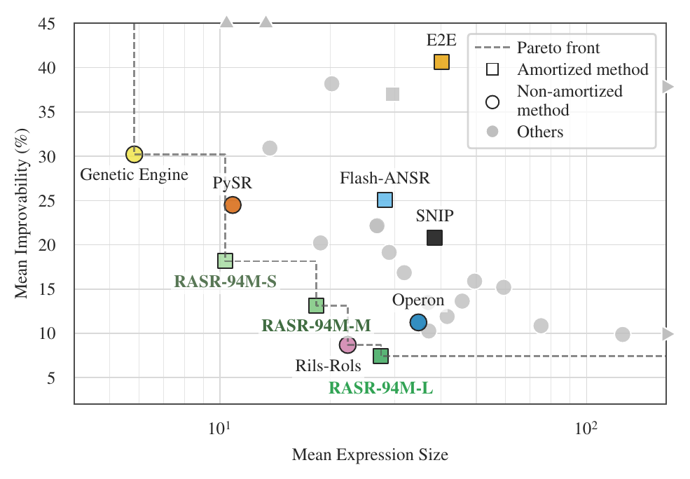

# RASR: Reinforced Amortized Symbolic Regression

[Paper (arXiv)](https://arxiv.org/abs/2610.17994) · [Models (Hugging Face)](https://huggingface.co/collections/davidotte/rasr) · [Tutorial](notebooks/tutorial.ipynb) · [Citation](#citation)

> **Note:** This is research code under active development. Some parts are still being
> polished and interfaces may change. Issues, questions, and feedback are very welcome.

RASR is a neural symbolic regression method. An encoder-decoder transformer reads a
tabular dataset and generates candidate expressions for it. RASR samples many
candidates, refines their constants numerically, and returns the Pareto front of fit
quality against expression size.

RASR makes two key changes to the training recipe:

1. **A diverse, data-realistic synthetic prior.** Inputs come from the prior of a
   tabular foundation model (TabICLv2), constants are sampled bottom-up conditioned on
   the data, targets carry heteroscedastic and structured noise, and everything is
   standardized.
2. **Two-stage training.** Supervised pre-training is followed by reinforcement-learning
   post-training (risk-sensitive GRPO) that rewards held-out fit and penalizes
   expression size.

On the black-box track of SRBench 2.0, RASR achieves the best mean test $R^2$ rank of
all evaluated methods. Three variants, post-trained with different size penalties, make
up most of the accuracy-complexity Pareto front. On the ground-truth tracks of
the original SRBench, RASR attains the highest solution rate of all methods on Strogatz
and is close behind the leaders on Feynman.

<p align="center">
  
</p>
<p align="center"><em>Mean expression size against mean improvability (relative RMSE gap to the best
method on each dataset, lower is better) on the SRBench 2.0 black-box track. Three of the five methods
on the Pareto front are RASR variants.</em></p>

This repository contains the training, post-training, and inference code, together
with the SRBench 2.0 evaluation harness.

## Setup

`torchtitan` and `srbench` are git submodules. Initialize them first (`torchtitan` is required for
training and for the pip install below, `srbench` for evaluation):
```bash
git submodule update --init --recursive
```

Python 3.12 or 3.13 is required. With [uv](https://docs.astral.sh/uv/) (recommended, uses the pinned
`uv.lock`), pick a torch backend (`cpu` or `gpu`, they conflict with each other) and add what you
need on top:
```bash
# Inference + tutorial notebook (append `--extra eval` for the SRBench evaluation extras)
uv sync --group gpu --extra notebook   # or --group cpu

# Full dev install (data generation, training, tests)
uv sync --group gpu --group data-gen --group training --group dev --extra notebook
```

With pip, install torch for your backend first (the uv index mapping in `pyproject.toml` is not seen
by pip), then the `torchtitan` submodule and the package with the extras you need:
```bash
# Torch backend: pick one
pip install torch --index-url https://download.pytorch.org/whl/cu126   # GPU (CUDA 12.6)
pip install torch --index-url https://download.pytorch.org/whl/cpu     # CPU only

# Inference + tutorial notebook (use ".[notebook,eval]" for the SRBench evaluation extras)
pip install -e ./torchtitan -e ".[notebook]"

# Full dev install: training/data-gen/dev are dependency groups, which need pip >= 25.1
pip install -e ./torchtitan -e ".[notebook]" --group data-gen --group training --group dev
```

## Try it

- **Tutorial notebook:** [`notebooks/tutorial.ipynb`](notebooks/tutorial.ipynb) loads a trained
  checkpoint and fits it to a dataset you draw by hand and to a real multivariate dataset, via the
  sklearn-style `RASR` estimator.
- **Trained checkpoints** (94M parameters) are hosted on Hugging Face. Passing a model ID as
  `model_path` downloads the weights on first use. A local checkpoint folder works as well.

  | Model | Description |
  |---|---|
  | [`davidotte/RASR-94M-L`](https://huggingface.co/davidotte/RASR-94M-L) | Default: post-trained at expression-size penalty $\lambda = 0.05$ |
  | [`davidotte/RASR-94M-M`](https://huggingface.co/davidotte/RASR-94M-M) | Post-trained at $\lambda = 0.15$, trades a little fit for smaller expressions |
  | [`davidotte/RASR-94M-S`](https://huggingface.co/davidotte/RASR-94M-S) | Post-trained at $\lambda = 0.5$, favors markedly smaller expressions |
  | [`davidotte/RASR-94M-base`](https://huggingface.co/davidotte/RASR-94M-base) | Pre-trained only, no post-training |

Minimal usage:

```python
from src.rasr.inference.rasr import RASR

model = RASR(model_path="davidotte/RASR-94M-L")
model.fit(X, y)
print(model.get_expression())
y_pred = model.predict(X)

for c in model.pareto_front_:  # Candidates not beaten on both fit and size.
    print(c.complexity, c.r2, c.expression_string)
```

Uses a GPU if one is available. On a CPU, pass a smaller `num_candidates` (default 256) for faster fits.

## Running on a cluster

The commands below run as-is on a single machine. For SLURM clusters, [`slurm/`](slurm/) contains
templates of the job scripts we used, and [`launch_scripts/`](launch_scripts/) wraps the training
ones with run naming and resuming. Before submitting, set the `#SBATCH -p <...-partition>` lines and
adapt the GPU/CPU counts and time limits to your cluster. Submit from the repo root and create the
log directories first (`mkdir -p output error`).

The SLURM training scripts log to WandB and expect an API key in `.wandb_key` at the repo root:
```bash
printf '%s\n' 'YOUR_WANDB_API_KEY' > .wandb_key
chmod 600 .wandb_key
```

## Data generation

Dataset creation writes Arrow shards consumed by pre-training and post-training, driven by the
`data_*.toml` configs in [`src/rasr/train_configs/`](src/rasr/train_configs/):
```bash
uv run --group data-gen --group cpu python -m src.rasr.data.generation.data_creator \
  --config src/rasr/train_configs/data_pre-train.toml

uv run --group data-gen --group cpu python -m src.rasr.data.generation.post_train_data_creator \
  --config src/rasr/train_configs/data_post-train.toml
```
Both accept `--task_id`/`--num_tasks` to shard generation across parallel jobs (default: single
shard). On SLURM, the array jobs in [`slurm/data/`](slurm/data/) do this sharding for you:
`sbatch slurm/data/dataset_creator.sh [config_path]` and
`sbatch slurm/data/post_train_data_creator.sh [config_path]`.

## Pre-training

Pre-training runs on `torchtitan`. Make sure the submodule is checked out (see Setup), then launch
from an environment with the training dependencies:
```bash
PYTHONPATH=.:torchtitan torchrun --standalone --nproc_per_node <num_gpus> -m torchtitan.train \
  --job.config_file=src/rasr/train_configs/pre-train.toml \
  --dataloader.data_path=<path/to/arrow/data> \
  --experimental.custom_import=src.rasr
```
`pre-train.toml` has working defaults for everything except the dataset path. Other config
overrides use dotted flags, e.g. `--model.flavor 24M --optimizer.lr 1e-3`.

On SLURM, the job runs inside an Apptainer/Singularity container built from the provided definition
(adjust cache/tmp dirs as needed):
```bash
export APPTAINER_CACHEDIR=/path/to/cache
export APPTAINER_TMPDIR=/path/to/tmp
apptainer build --fakeroot titan_0.2.1.sif titan_0.2.1.def
```
Then submit a new run, which is written to `experiments/runs/<run-name>/`:
```bash
RASR_DATA_PATH=<path/to/arrow/data> bash launch_scripts/launch_train.sh [run-name-suffix] [config-overrides...]
```
To resume an interrupted run: `bash launch_scripts/launch_train.sh --resume <run-name> [config-overrides...]`.
See the header of [`slurm/train.sh`](slurm/train.sh) for the remaining environment variables.

> **Known issue:** pre-training currently errors with `torch.compile` when running on a
> single GPU. Multi-GPU compiled runs and single-GPU eager runs are unaffected.

## Post-training

Post-training uses (risk-sensitive) GRPO starting from a pre-trained checkpoint and does not need
`torchtitan` or the container:
```bash
accelerate launch --num_processes <num_gpus> -m src.rasr.post_train.run \
  --model_path <pre-training run dir> \
  --config src/rasr/train_configs/post-train.toml \
  --post_training.dataloader.data_path <path/to/arrow/data>
```
`<model_path>` is a pre-training run directory (e.g. `experiments/runs/<run-name>/`), and config
overrides are namespaced under `--post_training.*`. As with pre-training, `post-train.toml` has
working defaults for everything except the dataset path. On SLURM:
```bash
bash launch_scripts/launch_post_train.sh <model_path> [run-name-suffix] --post_training.dataloader.data_path <path> [overrides...]
```
To resume: `bash launch_scripts/launch_post_train.sh --resume <run-dir> [overrides...]`.

## Exporting checkpoints

`RASR(model_path=...)` loads training run directories directly. To package a checkpoint as a
standalone `model.safetensors` directory, as for the released models, run:
```bash
python -m src.rasr.inference.convert_checkpoint <run-dir> <output-dir> [--step N]
```

## Evaluation

Evaluation uses our fork of [SRBench 2.0](https://github.com/cavalab/srbench), included as the
[`srbench/`](srbench/) submodule: the RASR, Flash-ANSR and SNIP wrappers live in `srbench/algorithms/`,
and `srbench/scripts/launch_evals.py` launches the evaluations. See
[`srbench/README.md`](srbench/README.md#rasr-evaluation-fork-of-srbench-20) for setup, launching and
merging results.

## Repository structure

```
src/rasr/
  data/generation/         synthetic prior sampling
  model/                   model architecture
  train_configs/           training and data generation TOML configs
  post_train/              RL post-training
  inference/               sklearn-style RASR estimator
notebooks/                 tutorial and prior sample notebooks
slurm/, launch_scripts/    SLURM job templates
srbench/                   SRBench 2.0 evaluation harness (submodule)
torchtitan/                torchtitan (submodule)
```

## Citation

If you use RASR in your work, please cite:

```bibtex
@misc{otte2026improvingneuralsymbolic,
  title         = {Improving Neural Symbolic Regression with a Diverse Prior and Post-training Alignment},
  author        = {David Otte and J{\"o}rg K.H. Franke and Frank Hutter},
  year          = {2026},
  eprint        = {2610.17994},
  archivePrefix = {arXiv},
  primaryClass  = {cs.LG},
  url           = {https://arxiv.org/abs/2610.17994}
}
```
